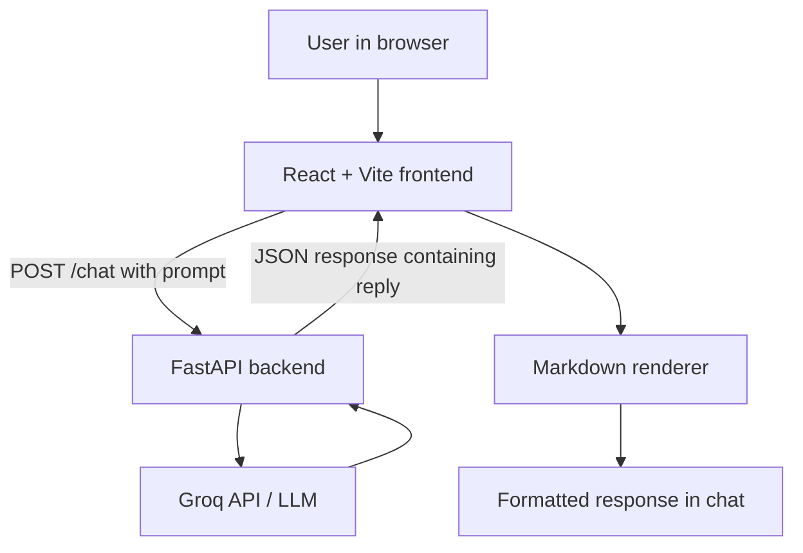

# 🤖 Nova.ai --- AI Chatbot with Groq

> **AI/LLM practice project** --- a full-stack AI chatbot with a React
> frontend and Python FastAPI backend, powered by Groq-hosted large
> language models (LLMs).

Nova.ai began as a terminal chatbot and has grown into a browser-based
chat application. The frontend sends prompts to a FastAPI endpoint, the
backend calls Groq, and the response is displayed in a custom chat
interface with Markdown formatting.

## 📌 Project Overview

Nova.ai lets users ask questions, explore ideas, get coding help, and
improve their writing through a web interface. This project focuses on
LLM API integration, frontend/backend communication, API design,
Markdown rendering, and user experience.

## 🎯 Goals

- Learn how Python communicates with a hosted LLM through an API.
- Build a full-stack application with React and FastAPI.
- Send prompts from a frontend to a backend endpoint.
- Understand system, user, and assistant messages and conversational
  context.
- Render AI-generated Markdown as readable content.
- Handle loading states, API errors, and environment-based secrets.
- Practise debugging model IDs and API requests.

## ✨ Features

- 💬 **Web chat interface** built with React.
- 🧠 **Groq-powered AI responses** from a supported LLM.
- 📝 **Markdown rendering** for headings, lists, tables, and code
  blocks.
- 📋 **Copy Markdown** to copy an assistant response.
- 💡 **Prompt suggestions** for explanations, coding, ideas, and
  writing.
- ⏳ **Loading indicator** while Nova.ai generates a response.
- 🔄 **New chat** to clear the current conversation.
- ⚠️ **Error feedback** when a request fails.
- 🔐 **Backend environment variables** for protecting the Groq API
  key.
- 📚 **FastAPI Swagger documentation** at `/docs`.

## 🧰 Technology Stack

---

Layer Technology Purpose

---

Frontend React Interactive chat
interface

Frontend tooling Vite Development server and
build tooling

Styling CSS Dark, glass-inspired UI

Markdown `react-markdown` Render Markdown as
React elements

Markdown extensions `remark-gfm` Tables and GitHub
Flavored Markdown

Backend Python, FastAPI Server-side logic and
HTTP API

LLM provider Groq API AI-generated responses

Configuration Environment variables, Backend secret
`python-dotenv` configuration

---

> **Model availability:** The project used `openai/gpt-oss-120b` during
> development. Model availability can change; check the [Groq model
> catalogue](https://console.groq.com/docs/models) and your account
> before running the project.

## 🏗️ Architecture



### Request flow

1.  The user types a prompt or chooses a suggested prompt.
2.  React sends a `POST` request to `/chat`.
3.  FastAPI calls the Groq API using the configured model.
4.  The backend returns the generated answer as JSON.
5.  React renders the answer using the Markdown renderer.
6.  The user can copy the response or start a new chat.

### API endpoints

Method Endpoint Purpose

---

`POST` `/chat` Accept a prompt and return an AI-generated reply
`GET` `/docs` Interactive FastAPI API documentation

The frontend currently sends JSON with a `prompt` field and reads the
response from `data.reply`.

Example request:

```json
{
  "prompt": "Explain how REST APIs work."
}
```

## 🗂️ Project Structure

The following is an illustrative structure; adjust paths and filenames
to match your repository.

```text
project/
├── backend/
│   ├── .env
│   ├── main.py
│   └── ... backend modules and dependencies
├── frontend/
│   ├── src/
│   │   ├── components/
│   │   │   ├── MarkdownRenderer.jsx
│   │   │   └── CopyMarkdownButton.jsx
│   │   ├── App.jsx
│   │   ├── App.css
│   │   └── main.jsx
│   ├── package.json
│   └── ...
└── README.md
```

## 🛠️ Requirements

- Python 3.10 or newer recommended.
- Node.js and npm.
- A Groq account and API key.
- Internet access.

## 🚀 Installation and Setup

Run the backend and frontend in **separate terminals**.

### 1. Clone or open the repository

```bash
git clone <your-repository-url>
cd <your-project-folder>
```

If the project is already on your computer, open its existing root
folder.

### 2. Set up the backend

Open the backend directory and create a virtual environment if needed.

**Windows PowerShell:**

```powershell
python -m venv .venv
.\.venv\Scripts\Activate.ps1
```

Install the backend packages used by the application:

```powershell
python -m pip install --upgrade pip
pip install fastapi uvicorn groq python-dotenv
```

If your repository already has `requirements.txt`, use
`pip install -r requirements.txt` instead.

Create a `.env` file in the location where your backend loads
environment variables:

```text
GROQ_API_KEY=your_groq_api_key_here
```

Replace the placeholder with your actual key. Never commit `.env` or put
the key in frontend code.

### 3. Start the backend

If the FastAPI instance is named `app` in `main.py`, run:

```powershell
uvicorn main:app --reload
```

```powershell
uv run uvicorn main:app --reload
```

Adjust the module path if your backend file has a different name. Open
`http://127.0.0.1:8000/docs` to check the API.

### 4. Set up the frontend

Open a second terminal:

```powershell
cd frontend
npm install
npm install react-markdown remark-gfm
```

The Markdown packages may already be installed and recorded in
`package.json`; in that case, `npm install` is sufficient.

### 5. Start the frontend

```powershell
npm run dev
```

Open the local URL printed by Vite, commonly `http://localhost:5173`.

The frontend currently calls `http://127.0.0.1:8000/chat`. If the
backend uses another host or port, update the frontend API URL or
configure it through a Vite environment variable.

### 6. Test the application

1.  Confirm the backend is running and `/docs` loads.
2.  Open the frontend in the browser.
3.  Ask:
    `Explain REST APIs using headings, a table, and a JavaScript code example.`
4.  Confirm the answer is formatted rather than showing raw Markdown
    syntax.
5.  Test the copy-response button and New chat control.

## 🔐 Security Notes

- Keep `GROQ_API_KEY` on the backend only.
- Do not expose secrets through `VITE_` variables; frontend variables
  are bundled into client-side code.
- Add `.env`, `.venv/`, `__pycache__/`, `node_modules/`, and build
  output to `.gitignore`.
- Configure FastAPI CORS to allow only trusted frontend origins when
  deploying.
- Add validation and rate limiting before exposing the API publicly.

Suggested `.gitignore` entries:

```gitignore
.env
.venv/
__pycache__/
*.py[cod]
node_modules/
dist/
```

## 🧠 What I Learned

- **LLM integration:** A Python backend can send requests to a hosted
  language model and return generated text.
- **Frontend/backend communication:** React can call a FastAPI
  endpoint over HTTP using JSON.
- **API design:** A consistent request/response structure makes
  integration easier.
- **Markdown rendering:** AI responses can be displayed as structured
  content instead of raw Markdown syntax.
- **Conversation context:** Earlier messages provide context only when
  the application includes them in later model requests; the model
  does not automatically remember separate API calls.
- **Environment variables:** API credentials should stay on the
  server.
- **Debugging:** Model availability, variable reassignment, request
  schemas, CORS, and server configuration can all affect the
  application.

## 🧯 Problems Faced and Solutions

### 1. Model ID unavailable

**Problem:** The earlier model ID `llama-3.3-70b-versatile` returned a
`404 model_not_found` error.

**Solution:** Check Groq's current model catalogue and use a model ID
available to the account. The project used `openai/gpt-oss-120b` during
development.

### 2. Selected model variable overwritten

**Problem:** A request returned a `400 BadRequestError` because the
model value did not match the expected schema.

**Cause:** The variable `model` was reused as the loop variable when
listing available models, overwriting the configured model ID.

**Solution:** Use separate names, such as `MODEL_ID` for the configured
ID and `available_model` for items returned by the model-list endpoint.

### 3. Raw Markdown displayed in responses

**Problem:** Characters such as `###`, `**`, and table separators
appeared as plain text.

**Solution:** Add `react-markdown` and `remark-gfm`, then render
assistant responses through `MarkdownRenderer`.

### 4. Frontend cannot reach backend

- Confirm FastAPI is running.
- Check that the frontend URL and endpoint are correct.
- Inspect the browser console and backend terminal.
- Check CORS settings if the browser reports a cross-origin error.
- Confirm the frontend sends `{"prompt": "..."}` and the backend
  returns a `reply` field.

## ⚠️ Current Limitations

- Messages are held in frontend state and are lost when the page is
  refreshed.
- There is no database, user authentication, or per-user conversation
  storage.
- Multi-turn context depends on what the backend maintains or sends to
  the model.
- The frontend uses a local backend URL by default and needs
  configuration for deployment.
- Live information such as weather requires an external data source or
  tool.
- Sending long histories on every request can increase token usage.
- Model access, rate limits, and usage costs depend on Groq and the
  account.

## 🚀 Possible Improvements

- Stream responses as they are generated.
- Persist conversations and add conversation management.
- Add authentication and per-user chat history.
- Configure the backend URL using environment-based frontend
  configuration.
- Add validation, tests, improved error handling, and rate limiting.
- Integrate tools for live information, such as weather.
- Add deployment configuration, logging, and accessibility
  improvements.

## 📚 Useful Links

- [Groq Console](https://console.groq.com/)
- [Groq model documentation](https://console.groq.com/docs/models)
- [FastAPI documentation](https://fastapi.tiangolo.com/)
- [React documentation](https://react.dev/)
- [Vite documentation](https://vite.dev/)
- [react-markdown](https://github.com/remarkjs/react-markdown)
- [remark-gfm](https://github.com/remarkjs/remark-gfm)

---

🌱 **Learning takeaway:** Nova.ai demonstrates a full-stack AI request
flow: collect a prompt in React, send it to a Python API, request a
response from an LLM, and render the result as readable Markdown in the
browser.
# nova-ai-chatbot

