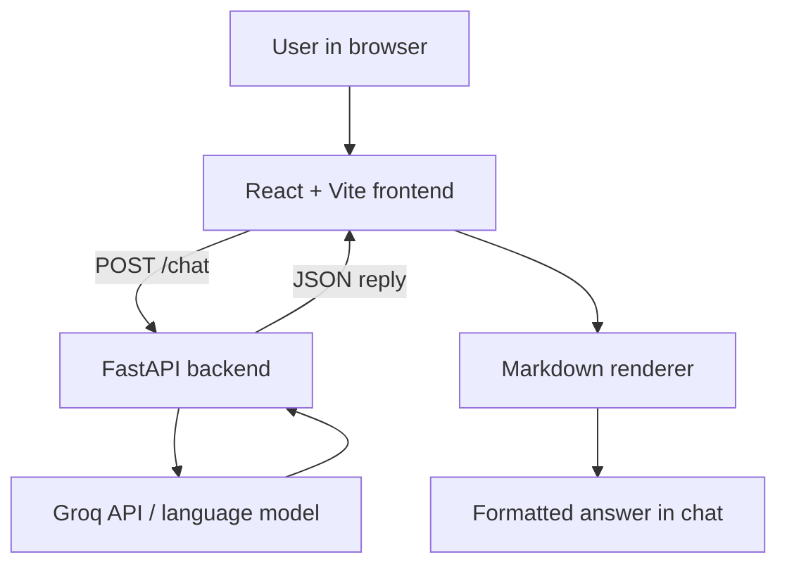

<!-- ::: {align="center"} -->

# 🤖 Nova.ai

### A full-stack AI chatbot powered by Groq

Chat with an AI assistant through a clean React interface backed by a
Python FastAPI API.

**React · Vite · Python · FastAPI · Groq**
:::

---

## ✨ Overview

Nova.ai started as a terminal-based chatbot and evolved into a
browser-based AI chat application. The React frontend sends a prompt to
the FastAPI backend, which requests a response from a Groq-hosted
language model and returns it to the interface.

This project explores practical LLM integration, frontend/backend
communication, API design, Markdown rendering, and user experience.

## 🚀 Features

- 💬 **Interactive chat UI** --- ask questions, explore ideas, get
  coding help, and improve writing.
- 🧠 **Groq-powered responses** --- generate answers using a supported
  language model.
- 📝 **Markdown rendering** --- display headings, lists, tables, and
  code blocks in a readable format.
- 📋 **Copy responses** --- copy an assistant response for reuse.
- 💡 **Prompt suggestions** --- start with suggested prompts for
  common tasks.
- ⏳ **Loading feedback** --- see when a response is being generated.
- 🔄 **New chat** --- clear the current conversation.
- ⚠️ **Error feedback** --- show a message when a request fails.
- 📚 **API documentation** --- explore FastAPI endpoints through
  Swagger UI at `/docs`.

## 🧰 Tech stack

---

Layer Technology Purpose

---

Frontend React Chat interface and
interactive UI

Frontend tooling Vite Development server and
build tooling

Styling CSS Dark interface and
visual styling

Markdown `react-markdown` Render Markdown as
React elements

Markdown extensions `remark-gfm` Tables and GitHub
Flavored Markdown

Backend Python, FastAPI Server-side logic and
HTTP API

AI provider Groq API Generate AI responses

Configuration Environment variables, Keep API credentials on
`python-dotenv` the backend

---

> **Model note:** During development, this project used
> `openai/gpt-oss-120b`. Model availability can change, so check the
> [Groq model catalogue](https://console.groq.com/docs/models) before
> running the project.

## 🏗️ How it works



### Request flow

1.  The user types a prompt or selects a suggestion.
2.  React sends a `POST` request to the backend's `/chat` endpoint.
3.  FastAPI sends the prompt to the configured Groq model.
4.  The backend returns the generated response as JSON.
5.  React renders the answer using the Markdown renderer.
6.  The user can copy the answer or start a new chat.

### API endpoints

Method Endpoint Purpose

---

`POST` `/chat` Accept a prompt and return an AI-generated reply
`GET` `/docs` Open interactive FastAPI documentation

The frontend sends JSON with a `prompt` field and reads the response
from `data.reply`.

Example request:

```json
{
  "prompt": "Explain how REST APIs work."
}
```

## 📁 Project structure

```text
nova-ai-chatbot/
├── backend/
│   ├── main.py
│   ├── helloLLM.py
│   ├── pyproject.toml
│   └── uv.lock
├── frontend/
│   ├── public/
│   ├── src/
│   │   ├── components/
│   │   │   ├── CopyMarkdownButton.jsx
│   │   │   └── MarkdownRenderer.jsx
│   │   ├── App.jsx
│   │   ├── App.css
│   │   ├── index.css
│   │   └── main.jsx
│   ├── package.json
│   └── package-lock.json
├── .gitignore
├── README.md
├── package.json
└── package-lock.json
```

The root-level `package.json` and `package-lock.json` are shown because
they currently exist in the repository. Keep them only if they serve a
purpose; the frontend has its own Node package files.

**Never commit `.env`, `.venv/`, `node_modules/`, or `__pycache__/`.**

## ⚙️ Requirements

- Python 3.10 or newer recommended
- Node.js and npm
- A [Groq account](https://console.groq.com/) and API key
- Internet access

## 🛠️ Setup and run locally

Run the backend and frontend in **separate terminals**.

### 1. Clone the repository

```bash
git clone https://github.com/PawarManish/nova-ai-chatbot.git
cd nova-ai-chatbot
```

### 2. Configure the backend

```powershell
cd backend
```

This project includes `pyproject.toml` and `uv.lock`. If you have
[uv](https://docs.astral.sh/uv/) installed, sync the dependencies:

```powershell
uv sync
```

Create a `.env` file in the backend directory if that is where the
application loads environment variables:

```env
GROQ_API_KEY=your_groq_api_key_here
```

Replace the placeholder with your real key. **Never commit the `.env`
file or put the key in frontend code.**

### 3. Start the backend

From the `backend` directory, if the FastAPI instance is named `app` in
`main.py`, run:

```powershell
uv run uvicorn main:app --reload
```

If your existing startup command differs, use the command that matches
your `main.py` configuration.

Open <http://127.0.0.1:8000/docs> to check that the API is running.

### 4. Start the frontend

Open a **second terminal** at the repository root:

```powershell
cd frontend
npm install
npm run dev
```

Open the local URL printed by Vite, commonly <http://localhost:5173>.

The frontend currently calls `http://127.0.0.1:8000/chat`. If your
backend uses a different host or port, update the API URL in the
frontend configuration.

### 5. Test the app

1.  Confirm the backend is running and `/docs` loads.
2.  Open the frontend in your browser.
3.  Ask:
    `Explain REST APIs using headings, a table, and a JavaScript code example.`
4.  Check that the response is formatted Markdown rather than raw
    Markdown syntax.
5.  Test the copy-response button and **New chat** control.

## 🔐 Security notes

- Keep `GROQ_API_KEY` on the backend only.
- Do not expose secrets through `VITE_` variables; frontend variables
  are bundled into client-side code.
- Ensure `.env`, `.venv/`, `__pycache__/`, `node_modules/`, and build
  output are ignored by Git.
- Configure FastAPI CORS to allow only trusted frontend origins when
  deploying.
- Add input validation and rate limiting before exposing the API
  publicly.
- If an API key has ever been committed to a public repository, revoke
  it and create a replacement.

## 🧠 What I learned

- **LLM integration:** call a hosted language model from a Python
  backend.
- **Frontend/backend communication:** connect React to a FastAPI
  endpoint over HTTP using JSON.
- **API design:** keep request and response formats consistent.
- **Markdown rendering:** display structured AI responses instead of
  raw Markdown.
- **Conversation context:** previous messages only provide context if
  included in later model requests.
- **Environment variables:** keep API credentials on the server.
- **Debugging:** troubleshoot model IDs, request schemas, CORS, and
  server configuration.

## 🧯 Challenges and solutions

### Model ID unavailable

An earlier model ID, `llama-3.3-70b-versatile`, returned a
`404 model_not_found` error.

**Solution:** Check Groq's current model catalogue and use a model
available to your account.

### Model variable overwritten

A request returned a `400 BadRequestError` because the configured model
value was overwritten while iterating over available models.

**Solution:** Use separate variable names, such as `MODEL_ID` for the
configured model and `available_model` for each listed model.

### Raw Markdown in responses

Markdown characters such as `###`, `**`, and table separators appeared
as plain text.

**Solution:** Render assistant responses through `react-markdown` with
`remark-gfm`.

### Frontend could not reach backend

- Confirm FastAPI is running.
- Check the frontend API URL and endpoint.
- Inspect the browser console and backend terminal.
- Check CORS settings if the browser reports a cross-origin error.
- Confirm the frontend sends `{"prompt": "..."}` and the backend
  returns a `reply` field.

## ⚠️ Current limitations

- Messages are held in frontend state and are lost when the page is
  refreshed.
- There is no database, user authentication, or per-user conversation
  storage.
- Multi-turn context depends on what the backend maintains or sends to
  the model.
- The frontend uses a local backend URL by default and needs
  configuration for deployment.
- Live information, such as weather, requires an external data source
  or tool.
- Long conversation histories can increase token usage.
- Model access, rate limits, and usage costs depend on Groq and the
  account.

## 🛣️ Future improvements

- Stream responses as they are generated.
- Persist conversations and add conversation management.
- Add authentication and per-user chat history.
- Configure the backend URL through environment-based frontend
  configuration.
- Add automated tests, input validation, improved error handling, and
  rate limiting.
- Integrate tools for live information.
- Improve deployment configuration, logging, accessibility, and
  responsive behavior.

## 📚 Useful links

- [Groq Console](https://console.groq.com/)
- [Groq model documentation](https://console.groq.com/docs/models)
- [FastAPI documentation](https://fastapi.tiangolo.com/)
- [React documentation](https://react.dev/)
- [Vite documentation](https://vite.dev/)
- [react-markdown](https://github.com/remarkjs/react-markdown)
- [remark-gfm](https://github.com/remarkjs/remark-gfm)

---

<!-- ::: {align="center"} -->

**Nova.ai** --- a learning project exploring the full-stack AI request
flow, from a React prompt to a Python API and a readable LLM response.

<!-- ::: -->
